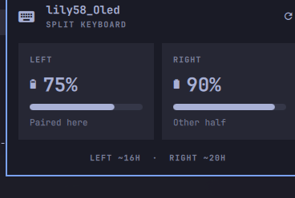

# Split keyboard battery

Omarchy bar widget for a Bluetooth split keyboard. It reads each half's battery from BlueZ and shows both on the bar. Click the widget for levels and a rough time remaining.

This is an Omarchy shell plugin for keyboards running [ZMK](https://zmk.dev/). It is not a ZMK firmware module. ZMK already reports battery over Bluetooth; this plugin displays that report.



## Install

```bash
omarchy plugin add https://github.com/lpepinelli/omarchy-plugins.git --enable
```

The widget lands in the right side of the bar. Move it with `omarchy bar` if you want it somewhere else.

## ZMK

A normal ZMK keyboard that uses BLE already exposes its battery. A single battery shows up as Left.

A split keyboard only exposes the half your computer is paired to, unless the central fetches the other half and publishes it. In the keyboard's ZMK config:

```
CONFIG_ZMK_SPLIT_BLE_CENTRAL_BATTERY_LEVEL_FETCHING=y
CONFIG_ZMK_SPLIT_BLE_CENTRAL_BATTERY_LEVEL_PROXY=y
```

Rebuild and flash the central after changing that. The paired half is Left. The other half is Right. If you paired the right half, those labels follow the pairing.

Any Bluetooth keyboard that exposes the standard Battery Service works the same way. The widget is not limited to a Lily58.

## What it shows

The bar label is the keyboard icon plus each half, like `75/90`. At or below the low-battery threshold the label turns urgent.

The panel names the keyboard, shows each half, and a refresh button. It also estimates time left from how fast the percentage falls. Until a half drops by at least a point, the footer says it is still estimating. After that it shows something like `LEFT ~16H · RIGHT ~20H`.

Samples stay in `~/.local/state/omarchy/split-keyboard-battery.json` on your machine. A charge of a few percent clears them and the estimate starts over.

## Settings

| Setting | Default | What it does |
| --- | --- | --- |
| Refresh interval | 60 seconds | How often the bar polls. Minimum 15. Opening the panel reads immediately and keeps polling every 30 seconds while it is open. Right-click the widget, or press `r` in the panel, to read now. |
| Low battery threshold | 20% | Bar label turns urgent at or below this. |
